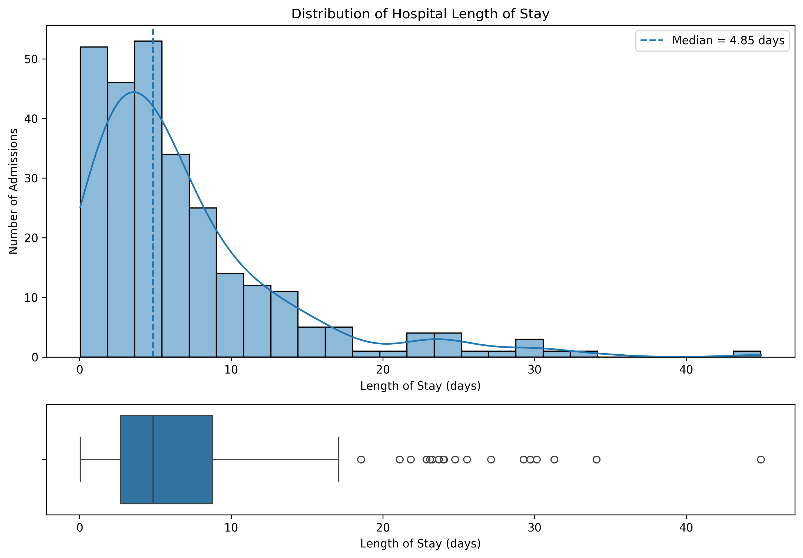
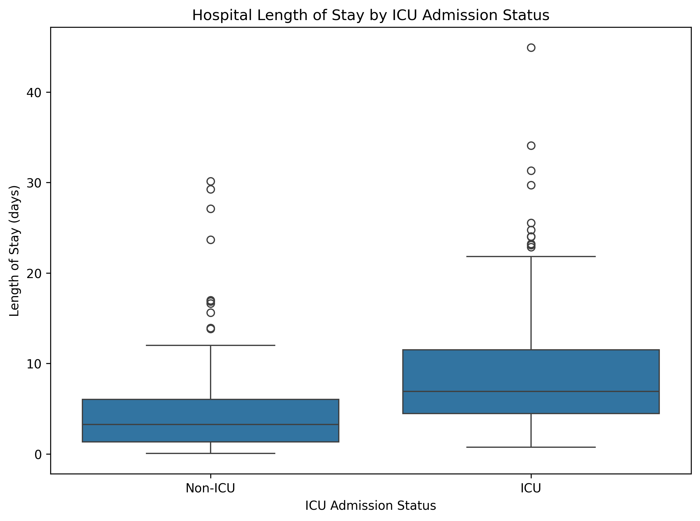
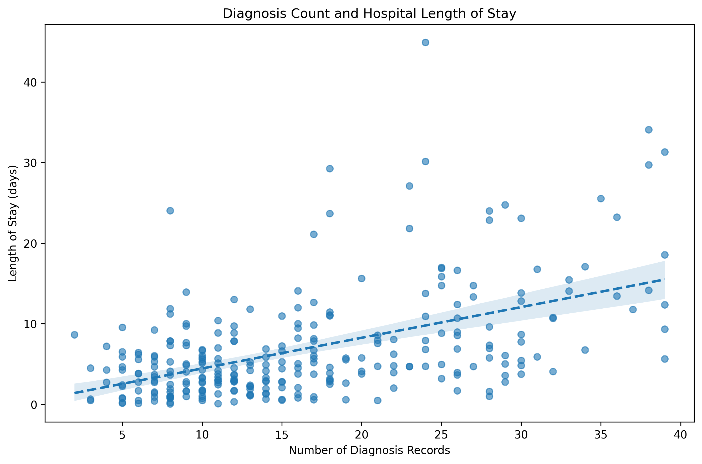
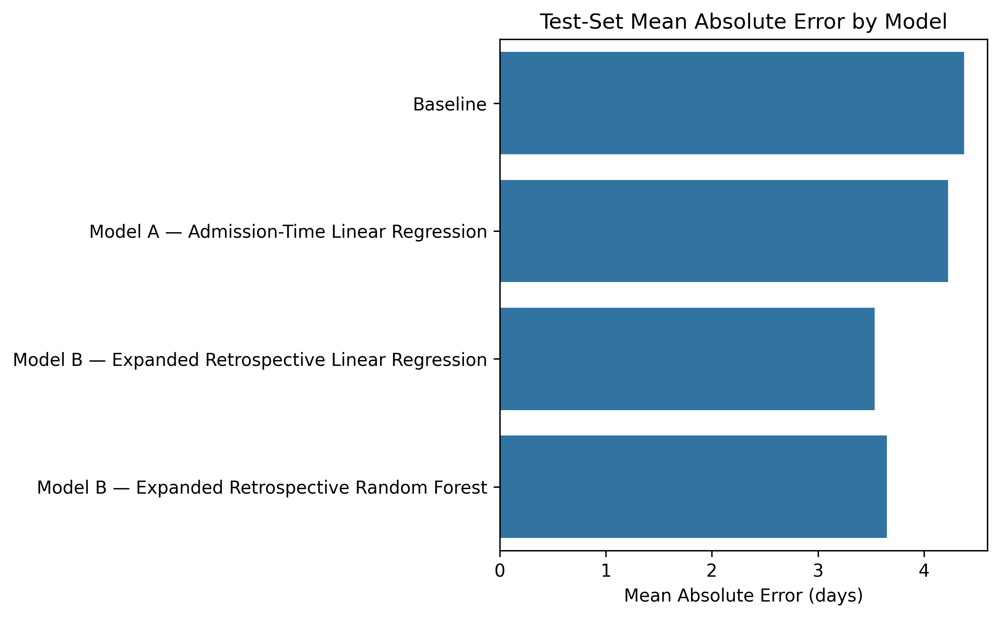

# Clinical Factors Associated with Hospital Length of Stay

**Clinical Data Analysis Portfolio Project | Python • Pandas • SciPy • scikit-learn**

## Project Overview

Hospital length of stay (LOS) is an important measure in healthcare operations, resource planning, and clinical management. This project analyzes electronic health record data from the **MIMIC-IV Demo** dataset to investigate factors associated with hospital LOS and to evaluate how well LOS can be predicted from different types of patient and hospitalization information.

The analysis integrates hospital admissions, patient demographics, ICU stays, and diagnosis records across **275 hospital admissions from 100 patients**.

The project combines:

- **Clinical data preparation and feature engineering**
- **Exploratory data analysis**
- **Non-parametric statistical analysis**
- **Predictive modeling and model comparison**
- **Standard and patient-grouped cross-validation**

Two prediction scenarios are distinguished throughout the analysis: an **admission-time model** using demographic and administrative information available at or near admission, and an **expanded retrospective model** that additionally incorporates information accumulated during hospitalization.

This distinction is important because variables associated with LOS are not necessarily useful for predicting LOS at the time of admission.

## Research Questions

This analysis addresses five main questions:

1. What is the distribution of hospital length of stay in the study population?
2. Is hospital LOS associated with **ICU utilization, diagnosis count, age group, or admission type**?
3. How well can LOS be predicted using demographic and administrative information available at or near admission?
4. How does predictive performance change when retrospective hospitalization information is added?
5. How does model performance change when validation is performed at the **patient level**, preventing admissions from the same patient from appearing in both training and validation sets?

## Dataset

This project uses the **MIMIC-IV Clinical Database Demo v2.2**, a publicly accessible demonstration subset of the MIMIC-IV electronic health record database.

The analysis integrates four source tables:

| Table | Information Used |
|---|---|
| `admissions` | Hospital admission and discharge information, admission characteristics, insurance, and race |
| `patients` | Patient demographics |
| `icustays` | ICU utilization and ICU length of stay |
| `diagnoses_icd` | ICD-coded diagnoses associated with each hospital admission |

After data-quality assessment and feature engineering, the analytical dataset contained **275 hospital admissions from 100 unique patients**, with one row representing one hospital admission.

The primary outcome was **hospital length of stay (LOS) in days**, calculated from admission and discharge timestamps.

Key engineered variables included:

- Age at hospital admission and age group
- ICU admission indicator
- Number of ICU stays
- Total ICU length of stay
- Diagnosis count per admission
- Grouped race category

**Note:** Diagnosis count is used as a proxy for documented diagnostic burden and should not be interpreted as a direct measure of disease severity.

## Analytical Workflow

The project followed an end-to-end clinical data analysis workflow:

1. **Data Quality Assessment**
   - Evaluated missing values, duplicate records, identifiers, and timestamps
   - Examined relationships between admissions, patients, ICU stays, and diagnosis records

2. **Data Preparation and Feature Engineering**
   - Integrated data from four MIMIC-IV tables
   - Calculated hospital LOS and age at admission
   - Aggregated ICU and diagnosis information to the hospital-admission level
   - Constructed a one-row-per-admission analytical dataset

3. **Exploratory Data Analysis**
   - Examined the distribution of hospital LOS
   - Compared LOS across patient and hospitalization characteristics
   - Explored the relationship between diagnosis count and LOS

4. **Statistical Analysis**
   - Mann–Whitney U test for ICU versus non-ICU admissions
   - Spearman rank correlation for diagnosis count and LOS
   - Kruskal–Wallis tests for age groups and admission types

5. **Predictive Modeling and Validation**
   - Established a mean-prediction baseline
   - Developed admission-time and expanded retrospective linear regression models
   - Compared linear regression with Random Forest regression
   - Evaluated performance using MAE, RMSE, and R²
   - Performed standard and patient-grouped five-fold cross-validation


## Key Findings

### Hospital Length of Stay

Hospital LOS was strongly right-skewed, with a **median of 4.85 days** and a **mean of 6.88 days**.



### ICU Utilization and Length of Stay

Admissions involving ICU care had substantially longer hospital stays. Median LOS was **6.92 days for ICU admissions** compared with **3.26 days for non-ICU admissions**.

The difference was statistically significant (**Mann–Whitney U test, p < 0.001**).



### Diagnosis Count and Length of Stay

Diagnosis count showed a **moderate positive association** with hospital LOS (**Spearman ρ = 0.470, p < 0.001**).



Diagnosis count is used as a proxy for documented diagnostic burden and should not be interpreted as a direct measure of disease severity.

### Other Statistical Findings

- LOS distributions differed significantly across **admission types** (**Kruskal–Wallis, p < 0.001**).
- No statistically significant difference in LOS was detected across the four **age groups** examined (**Kruskal–Wallis, p = 0.532**).
- The demographic and administrative variables available at admission provided only limited ability to predict individual LOS.
- Predictive performance improved when ICU admission and diagnosis count were added, but these variables represent information observed or accumulated during hospitalization and therefore cannot be interpreted as admission-time predictors.


## Predictive Modeling Results

Two modeling scenarios were used to distinguish **admission-time prediction** from **retrospective analysis**.

### Model A — Admission-Time Model

Model A used information available at or near hospital admission:

- Age at admission
- Gender
- Admission type
- Insurance
- Race group

### Model B — Expanded Retrospective Model

Model B additionally included:

- Diagnosis count
- ICU admission

These variables provide information about the hospitalization but become available during the hospital stay. Model B therefore represents a **retrospective analytical model**, not an admission-time clinical prediction model.

### Held-Out Test Set Performance

| Model | MAE (days) | RMSE (days) | R² |
|---|---:|---:|---:|
| Mean baseline | 4.38 | 5.78 | -0.001 |
| Model A — Linear Regression | 4.23 | 5.70 | 0.025 |
| Model B — Linear Regression | **3.53** | **4.92** | **0.274** |
| Model B — Random Forest | 3.65 | 5.48 | 0.100 |



The admission-time model provided only a small improvement over the mean-prediction baseline. Adding diagnosis count and ICU admission improved predictive performance substantially. Random Forest regression did not outperform the simpler expanded linear regression model in this dataset.

### Cross-Validation

| Model | Standard 5-Fold CV R² | Patient-Grouped CV R² |
|---|---:|---:|
| Model A | 0.060 ± 0.064 | 0.016 ± 0.126 |
| Model B | 0.294 ± 0.100 | 0.211 ± 0.145 |

Patient-grouped cross-validation kept all admissions from the same patient within the same fold. Performance decreased under this stricter validation strategy, indicating that admission-level validation may somewhat overestimate generalization to previously unseen patients.

Despite the lower grouped-validation performance, the overall conclusion remained consistent: the selected admission-time variables provided little predictive information, whereas the expanded retrospective model explained more variation in LOS.

## Technologies Used

- **Python** — data analysis and modeling
- **pandas** — data integration, cleaning, aggregation, and feature engineering
- **NumPy** — numerical operations
- **Matplotlib & Seaborn** — exploratory and statistical visualization
- **SciPy** — non-parametric statistical testing
- **scikit-learn** — preprocessing, regression modeling, model evaluation, and cross-validation
- **Jupyter Notebook** — development and documentation of the analytical workflow

## Repository Structure

```text
mimic-iv-los-analysis/
│
├── README.md
│
└── figures/
    ├── los_distribution.png
    ├── los_by_icu.png
    ├── diagnosis_count_vs_los.png
    └── model_mae_comparison.png
```

This public repository presents the methodology, selected results, and visualizations from the analysis. The working Jupyter notebook and source data are maintained separately and are not included in the public repository.

## Limitations

This project is an exploratory analysis using the **MIMIC-IV Demo** dataset and should not be interpreted as a clinically validated prediction model.

Key limitations include:

- The dataset contains only **100 patients and 275 hospital admissions**, limiting statistical precision and model development.
- Some patients contributed multiple admissions. Patient-grouped cross-validation was therefore used to assess generalization to previously unseen patients.
- The admission-time model used a limited set of demographic and administrative variables and did not include richer clinical information such as laboratory measurements, vital signs, comorbidities, or severity scores.
- Diagnosis count is a proxy for documented diagnostic burden rather than a direct measure of disease severity.
- ICU admission and diagnosis count represent information observed or accumulated during hospitalization and therefore cannot be interpreted as admission-time predictors.
- The statistical association tests did not explicitly account for clustering of repeated admissions within patients.
- No external dataset was used for model validation.

The results should therefore be interpreted as a demonstration of a **clinical data-analysis and modeling workflow**, rather than evidence for clinical deployment or causal relationships.

## Data Access

This project uses the **MIMIC-IV Clinical Database Demo v2.2**, provided by PhysioNet.

The Demo dataset contains deidentified electronic health record data for a subset of **100 patients** and is publicly accessible. The source clinical data are not redistributed in this repository.

**Dataset:** MIMIC-IV Clinical Database Demo v2.2  
**Provider:** PhysioNet  
https://physionet.org/content/mimic-iv-demo/2.2/  
DOI: `10.13026/dp1f-ex47`

The dataset can be obtained directly from the official PhysioNet MIMIC-IV Demo page.

### Data Citation

Johnson, A., Bulgarelli, L., Pollard, T., Horng, S., Celi, L. A., & Mark, R. (2023). *MIMIC-IV Clinical Database Demo (version 2.2).* PhysioNet. https://doi.org/10.13026/dp1f-ex47


